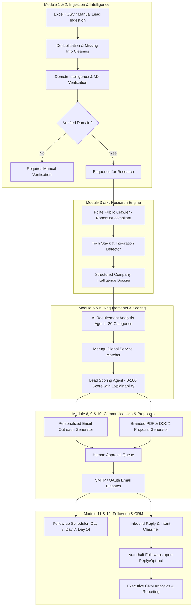

# MERUGU AI BPO – Intelligent Lead Research & Business Automation Platform

Production-ready, enterprise-grade AI automation platform developed for **Merugu Digital Marketing And Life Science Pvt. Ltd. (Merugu Global)**.

The platform autonomously automates the complete business development and BPO lead-processing lifecycle:
- Ingestion & deduplication of Excel / CSV / CRM leads
- Corporate email domain verification & confidence scoring
- Polite public website crawling with tech stack detection & gap discovery
- AI business requirement analysis across 20 distinct industry categories
- Multi-factor lead qualification scoring (0–100) with full explainability
- Personalized email drafting with strict anti-hallucination guardrails
- Automated proposal & quotation document generation (Branded PDF & DOCX)
- Human approval workflows, email dispatch, and automated follow-up cadences (Day 0, 3, 7, 14)
- Response sentiment analysis and real-time CRM reporting

---

## 1. System Architecture



---

## 2. The 12 Specialized AI Agents Matrix

| Agent | Name | Primary Role | Permitted Tools / Inputs |
|---|---|---|---|
| **Agent 1** | Lead Validation Agent | Validates email syntax, identifies missing contact data, flags anomalies | Regex, TLD parser |
| **Agent 2** | Company Discovery Agent | Matches domain with official business registry and websites | Search APIs, Public Registry |
| **Agent 3** | Website Research Agent | Crawls public pages, extracts headings/text, detects tech stack | BeautifulSoup, Polite Crawler |
| **Agent 4** | Business Intelligence Agent | Synthesizes business models, products, operating countries | LLM reasoning, crawl texts |
| **Agent 5** | Requirement Analysis Agent | Identifies gaps across 20 technical categories backed by direct evidence | LLM prompt chains, gap audits |
| **Agent 6** | Lead Scoring Agent | Computes explainable 100-pt score across 6 objective criteria | Deterministic weighted engine |
| **Agent 7** | Service Matching Agent | Accurately maps requirements strictly to Merugu Global catalogue | Vector/keyword catalogue matcher |
| **Agent 8** | Email Generation Agent | Drafts personalized emails across 10 categories without hallucinations | Research facts, approved templates |
| **Agent 9** | Proposal Generation Agent | Generates SOWs, deliverables, timelines, and milestones | Architecture blueprints |
| **Agent 10** | Email Response Analysis Agent | Classifies replies (Interested, Meeting, Quote, Out of Office, Unsubscribe) | Intent classification model |
| **Agent 11** | Follow-up Agent | Crafts context-aware cadence follow-ups (Day 3, 7, 14) | Thread context, outreach history |
| **Agent 12** | Reporting Agent | Synthesizes daily operational briefs, conversion bottlenecks & manager insights | PostgreSQL analytics aggregation |

---

## 3. Technology Stack

- **Backend**: Python 3.11+, Django 5.0, Django REST Framework, Celery 5.4, Redis 7.0
- **Database**: PostgreSQL (with automatic SQLite fallback for local development)
- **Document Generation**: ReportLab (Branded Vector PDFs), python-docx (Editable Word Proposals)
- **Frontend**: React 18, TypeScript, Tailwind CSS, Vite, Lucide Icons
- **AI Gateway**: OpenAI API (`gpt-4o`) with fallback deterministic inference engine

---

## 4. Quick Start & Installation

### Option A: Running Locally

#### 1. Backend Setup
```bash
cd backend

# Create and activate virtual environment
python -m venv venv
# On Windows:
.\venv\Scripts\activate
# On Linux/macOS:
source venv/bin/activate

# Install dependencies
pip install -r requirements.txt

# Run migrations
python manage.py migrate

# Seed initial admin user, Merugu Global services, and demo leads
python seed_data.py

# Start Django development server
python manage.py runserver 127.0.0.1:8000
```

> **Default Superuser**: `admin` | **Password**: `adminpassword123`

#### 2. Celery Worker & Beat (Optional for Background Tasks)
```bash
# In separate terminal windows:
celery -A merugu_bpo worker -l info
celery -A merugu_bpo beat -l info
```

#### 3. Frontend Setup
```bash
cd frontend

# Install dependencies
npm install

# Start Vite dev server
npm run dev
```
Open [http://localhost:3000](http://localhost:3000) in your browser.

---

### Option B: Docker Compose (Full Stack in One Command)

```bash
docker-compose up --build
```
This boots:
- PostgreSQL on port `5432`
- Redis on port `6379`
- Django REST API on [http://localhost:8000](http://localhost:8000)
- Celery worker & beat schedulers
- React frontend on [http://localhost:3000](http://localhost:3000)

---

## 5. Security & Compliance Safeguards

1. **Anti-Spam & Deliverability Guard**: Hard cap of 150 emails/day per connected account to protect corporate domain reputation.
2. **Polite Web Crawler**: Respects `robots.txt`, executes 1-second polite crawl delays, accesses public pages only, and never attempts CAPTCHA bypass.
3. **Strict Anti-Hallucination Guard**: Outreach emails and proposals are derived strictly from observable website evidence and approved catalogue pricing.
4. **Human-in-the-Loop Approval Queue**: Outreach and proposals default to `AWAITING_APPROVAL` status before sending.
5. **Auto-Halt Follow-up Cadence**: Immediately suppresses remaining follow-up emails upon receiving an incoming reply or opt-out.
